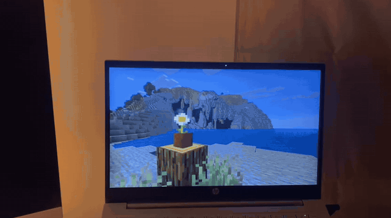
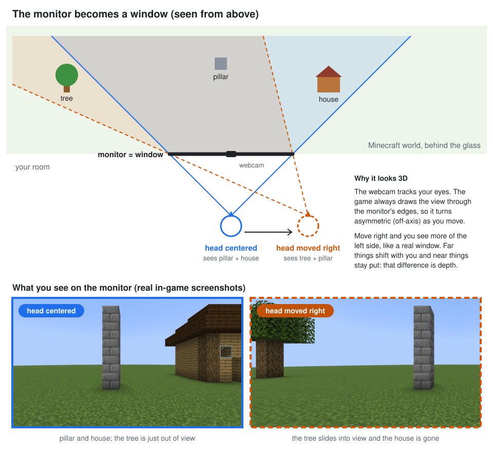

# Minecraft Parallax

<p align="center">
  
  <br>
  <sub>Filmed with a phone moving around the laptop. The webcam tracks the viewer's head, so the scene behind the screen shifts like a real window would.</sub>
</p>

A Fabric mod for **Minecraft 26.3** that turns your monitor into a window into the world. A webcam tracks your head, and the game renders from where your eyes actually are, using an off-axis projection (the "fish tank VR" / Johnny Lee Wii head-tracking effect). Lean left and you see more of what's to the right behind the window frame. Lean in and the window gets wider. Turn your head and the view turns with it, like TrackIR. That part is amplified, so you can look around while your eyes stay on the screen.

<p align="center">
  
</p>

## Quick start

1. **Start the head tracker.** The first run creates `tracker/.venv` and installs MediaPipe:
   ```bash
   ./tracker/run_tracker.sh
   ```
   A preview window opens with your x / y / z in centimetres and your head yaw / pitch / roll. An orange line shows the direction your face points. Move right and x should go up, move up and y should go up, lean in and z should go down. Turning right should make yaw go up, and looking up should make pitch go up. If left and right are swapped, press `m`.

2. **Start Minecraft with the mod.** Either way works:
   - **Dev client, no launcher needed:** `./gradlew runClient`
   - **Your normal launcher:** install Fabric Loader (0.19.5 or newer) for 26.3. Then put [Fabric API](https://modrinth.com/mod/fabric-api) `0.164.0+26.3` and `build/libs/minecraft-parallax-1.0.0.jar` in your `mods` folder.

3. Join a world and sit how you normally sit. About a second after tracking data arrives, the mod centers on your current head position and fades the effect in. Press **F8** to recenter at any time. Press **F11** for fullscreen: the effect assumes the game fills the screen.

## Settings menu

Press **F6**, click **Minecraft Parallax...** in the bottom-left corner of the pause menu, or type `/parallax menu`. The menu has:

- **Status & keys:** whether the tracker is connected, what each key does, **Recenter now**, and a shortcut to rebind keys.
- **Mode:**
  - **Window only:** moving your head moves the view behind the screen.
  - **Window + head look:** turning your head also turns the view.
- **Head look:** left/right and up/down amplification (default ×2.0 / ×1.5), deadzone, and maximum look angle. These are greyed out in *Window only* mode.
- **Depth effect:** strength, window distance, smoothing, and whether the crosshair follows your aim.
- **Other:** third person, auto recenter, status overlay, and **Reset to defaults**, which keeps your calibration.

Changes apply immediately, so you can watch them in the world behind the menu. They're saved when you close the menu.

To add a setting, create it with `toggle(...)` or `slider(...)` in `ParallaxScreen.addOptions()` and add its text to `assets/minecraft_parallax/lang/en_us.json`.

## Keys

You can rebind these under *Options → Controls → Minecraft Parallax*. On many laptops you may need to hold Fn.

| Key | Action |
|-----|--------|
| F7 | Toggle the effect (fades in and out) |
| F8 | Recenter: your current head position becomes the neutral, vanilla-looking view |
| F9 | Status overlay (tracker rate, eye position, camera offset) |
| F6 | Settings menu |

## Calibration

- **Screen size.** The default is 30.9 × 17.4 cm, a typical 14" laptop panel. For another screen, use `/parallax set screenWidthCm …` and `screenHeightCm …`.
- **Depth.** Sit with your eyes exactly 50 cm from the screen (use a ruler or tape), then press `c` in the tracker window. The result is saved to `tracker/calibration.json`. To calibrate at a different distance, start the tracker with `--calib-distance 60` instead.
- **Camera position.** The default assumes the webcam is centered 9.7 cm above the middle of the screen, which fits a 14" laptop bezel. For an external webcam, use `--cam-offset-x/-y/-z` (cm, relative to the screen center).
- **Camera FOV.** The default is `--hfov 80`, which fits a typical built-in laptop webcam. This only affects how left/right/up/down is scaled, because depth calibration corrects distance.

Run `./tracker/run_tracker.sh --help` for every option, including `--camera 1` and `--no-preview`.

## In-game commands

```
/parallax                  status
/parallax menu             open the settings menu
/parallax toggle | recenter | reload | reset
/parallax get              list all options
/parallax set <option> <value>
```

Useful options (all are stored in `config/minecraft_parallax.json`):

| Option | Default | What it does |
|--------|---------|--------------|
| `windowDistanceBlocks` | 1.0 | Where the virtual glass sits. Things at this distance stay still. Larger values make close things pop out of the screen. Smaller values put everything behind it. |
| `strength` | 1.0 | Exaggerates head movement. 1 is physically correct. Try 1.5–2 for a stronger effect. |
| `physicalFov` | false | true uses the real angle your screen covers instead of your FOV setting: true to life, but very zoomed in. |
| `viewMode` | WINDOW_AND_HEAD_LOOK | `WINDOW` (head position only) or `WINDOW_AND_HEAD_LOOK`: turning your head turns the view. This is visual only: you keep aiming and walking where the mouse points, and the crosshair stays on that spot. |
| `rotationYawGain`, `rotationPitchGain` | 2.0, 1.5 | View degrees per degree of head turn. |
| `rotationDeadzoneDegrees` | 2.0 | Ignores small head turns so the view doesn't wobble. |
| `rotationMaxDegrees` | 70 | The furthest the view can turn away from your aim. |
| `invertYaw`, `invertPitch` | false | Flip the turn direction. |
| `autoRecenter` | true | Center on your head position the first time tracking connects after the game starts. |
| `smoothingSeconds` | 0.03 | Extra smoothing on top of the tracker's filter. |
| `crosshairFollowsAim` | true | Keeps the crosshair on the block you're actually aiming at while the view is shifted. |
| `collision` | true | Stops the camera before it enters walls when you lean into them. |
| `maxOffsetBlocks` | 1.5 | Hard limit on how far the camera can move. |
| `applyInThirdPerson` | true | Also apply the effect in F5 views. |
| `udpPort`, `udpBindAddress` | 4242, 127.0.0.1 | Where the mod listens. |
| `invertX/Y/Z` | false | Flip an axis, for example when the data comes from OpenTrack. |

## Using OpenTrack instead

The mod reads OpenTrack's *UDP over network* output: six little-endian doubles (x, y, z in cm, then yaw, pitch, roll). Point OpenTrack at `127.0.0.1:4242`.

OpenTrack reports positions relative to its own center instead of the screen, so set `neutralDistanceCm` to your real viewing distance. You may also need to set `invertX`/`invertZ`.

## How it works

- The tracker gets head yaw, pitch and roll from MediaPipe's 3D face pose matrix. Recentering stores your neutral angles; the camera then turns by gain × (angle − neutral − deadzone). The crosshair is re-projected from your real aim direction into the turned view.
- The tracker finds the point between your eyes with MediaPipe Face Landmarker. It gets the distance from the 3-D separation of your eye centers, which stays stable when you turn your head, then converts to screen-relative centimetres. It smooths x, y and z with a One-Euro filter and sends one packet per camera frame.
- Each frame, the mod moves the camera along its own right/up/back axes. It then replaces the projection with an **asymmetric frustum** whose edges always pass through the edges of a fixed virtual window. Distant objects move with your head and near ones stay put, which is exactly what a real window does.
- In your neutral position the image is identical to vanilla. The mapping keeps your FOV setting by scaling the frustum uniformly.
- Hooks (Mixin): `Camera.update` applies the offset before culling. `Camera.createProjectionMatrixForCulling` makes the cull frustum match the off-axis view, so chunks don't pop at the edges. `Projection.getMatrix` swaps in the off-axis matrix, using reverse-Z exactly like vanilla. The crosshair is re-projected through Fabric's HUD API.

## Automated in-game test

```bash
./gradlew runClientGameTest
```

This builds a test scene, streams fake head positions over UDP and saves screenshots to `build/run/clientGameTest/screenshots/` (vanilla, centered, left, right, up, closer, further, disabled, third person, head turns, eyes outside the screen, leaning into a wall).

## Building

```bash
./gradlew build      # → build/libs/minecraft-parallax-1.0.0.jar
```

Gradle automatically downloads the Java 25 it needs; Minecraft 26.x requires Java 25.
